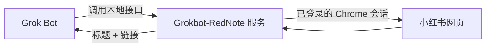

<div align="center">


<h1>Grokbot-RedNote</h1>

<p><strong>嘿人类，这不是给你用的。</strong></p>

<p><strong>专供 Grok Bot 使用：让它具备搜索小红书内容的能力，并把结果带回与你的对话里。</strong></p>

<table align="center">
<tr>
<td align="center" valign="top" width="512">

<br>
<sub><b>小红书</b><br>Drunk　955473847</sub>
</td>
<td align="center" valign="top" width="512">

<br>
<sub><b>干活不易～请我喝杯奶茶？</b></sub>
</td>
</tr>
</table>

<p>目前还在开发状态，如有bug欢迎小红书私信，想只夸夸我也不是不可以啦～ -v-</p>

<p><sub>目前仅支持macOS · 开发中 · 未经授权不能商用</sub></p>

</div>

> [!IMPORTANT]
> 这是一个**非官方**工具，开源（干活不易求打赏-v-）。它使用你自己 *已登录* 的 Chrome 会话访问小红书网页，与小红书、xAI 均无合作、授权。（如果说我是cursor和grokbot的月度股东...倒也算是（开玩笑））。

## 🧭 它是什么

Grokbot-RedNote 是给 Grok Bot 用的工具，不是给人操作的搜索程序。他直击我们用户想调用grokbot搜索小红书的内容但是被拦截的痛点。小红书由 Grok Bot 亲自检索，标题和链接回到它自己的对话里；本地服务只借助你已登录的 Chrome 会话做只读访问。macOS 窗口只用来显示工作过程动画和已保存的结果，窗口里没有搜索框或输入框。

作者：Hongtian Chan（[chenhongtian.com](https://chenhongtian.com/)，你也可以叫他Drunk）。

## 🧩 工作原理



- 本地 HTTP 服务跑在 `127.0.0.1:18765`。
- Grok Bot 请求 `/search?q=` 搜索，再按需请求 `/note?url=` 打开笔记；笔记链接经 `/go` 跳到带 `xsec_token` 的官方分享地址。
- 返回给对话的是标题和链接，而不是整页转述。

## 🎨 界面

中央是红色的GrokBot：忙碌时是思考动画和省略号，结束后再回到待机状态。

精选和搜索记录在头像左侧，全部结果在右侧，都是按钮，点开后展开列表；可分别清空结果或清空记录。设置不放在窗口里。

## ⏱ 请求节奏

每日搜索上限已经在本地执行：普通/免费用户每天 10 次，订阅/付费用户每天 200 次，按这台电脑的当地时间零点重置。重启应用、再开一次仓库副本，或只删掉其中一个计数文件，都不会清零。

次数写在本机的 `~/Library/Application Support/Grokbot-RedNote/state.json`，并有一份带校验签名的副本在 `~/Library/Caches/Grokbot-RedNote/usage.json`，两份都绑在这台机器的硬件标识上。付费档通过本机 `subscription.json`（内容如 `{"tier": "paid"}`）、环境变量 `GROKBOT_REDNOTE_TIER=paid`，或启动参数 `--tier paid` 识别；默认是免费档。触及上限或出现错误时，窗口里的机器人会切到哭泣动画。

本地预览哭泣状态（不会消耗次数）：服务运行时访问 `http://127.0.0.1:18765/preview?scene=limit`，或在浏览器打开 `http://127.0.0.1:18765/?preview=limit`。用 `?scene=off` 退出预览。

本地还会保存最近 50 条搜索记录（`learn.jsonl`），超出的旧记录会自动裁掉。`/tmp` 里的钩子搜索缓存只保留应用需要的编号文件，多余的转储会被清掉。

搜索记录、权重、设置和次数文件在本机加密存放。密钥由这台电脑的硬件标识经 PBKDF2 派生；加解密使用系统自带的 AES-256（CommonCrypto），不另装 Python 包。读取时自动解密；若文件仍是明文，下次写入会改成密文。损坏的文件会改名为 `.corrupt` 并重建。只读 Chrome 会话和 `127.0.0.1` 绑定没有改动。

## 🛠 从零安装

macOS 13+，Python 3.9+，无需 `pip install`。仓库不包含现成的 `Grokbot-RedNote.app`，需要在本机先构建。先用 Chrome 登录 [小红书网页](https://www.rednote.com/)。克隆后先构建应用，再运行 `./install.sh` 即可完成配置并启动服务，无需手动改路径。

```sh
git clone https://github.com/HongtianChan/Grokbot-RedNote.git
cd Grokbot-RedNote
```

若尚未安装 Xcode 或 Command Line Tools，先运行 `xcode-select --install`。仓库里没有 `.xcodeproj`；用 Swift 编译器在项目根目录生成应用包，产物是当前目录下的 `Grokbot-RedNote.app`：

```sh
mkdir -p Grokbot-RedNote.app/Contents/MacOS Grokbot-RedNote.app/Contents/Resources
cp macos/Info.plist Grokbot-RedNote.app/Contents/Info.plist
cp assets/icon.icns Grokbot-RedNote.app/Contents/Resources/icon.icns
swiftc macos/main.swift \
  -o Grokbot-RedNote.app/Contents/MacOS/Grokbot-RedNote \
  -framework Cocoa -framework WebKit \
  -target "$(uname -m)-apple-macosx13.0"
```

构建完成后运行：

```sh
./install.sh
```

## 🚀 如何运行

建议直接把仓库链接丢给grokbot叫grokbot帮你配置！

1. 用 Chrome 默认配置登录 [小红书网页](https://www.rednote.com/)。
2. 按上面的步骤在本机构建 `Grokbot-RedNote.app`。若已经运行过 `./install.sh`，服务已在 `127.0.0.1:18765` 上启动，不要再启动一次（端口会被占用）。直接打开 `Grokbot-RedNote.app`。
3. 如果服务还没在跑，先在项目目录启动一次，再打开应用：

```sh
/usr/bin/python3 src/grokbot_rednote.py --service
```

然后打开 `Grokbot-RedNote.app`。只先打开应用时，新的权限提示可能导致服务迟迟起不来。

4. 服务地址：`http://127.0.0.1:18765`。可用 `GET /health` 做健康检查，用 `GET /status` 查看当前状态。
5. 保持窗口或服务运行，即可让 Grok Bot 调用搜索。

仓库由 Hongtian Chan 维护：[HongtianChan/Grokbot-RedNote](https://github.com/HongtianChan/Grokbot-RedNote)。

## ⚖️ 使用限制

本项目未经授权不能商用。

## 👤 作者

- 个人网站：[chenhongtian.com](https://chenhongtian.com/)
