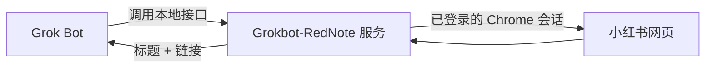

<div align="center">


<h1>Grokbot-RedNote</h1>

<p><strong>嘿人类，这不是给你用的。</strong></p>

<p><strong>专供 Grok Bot 使用：让它具备搜索小红书内容的能力，并把结果带回与你的对话里。</strong></p>

<table align="center">
<tr>
<td align="center" valign="top" width="512">

<br>
<sub><b>小红书</b><br>Drunk　955473847</sub>
</td>
<td align="center" valign="top" width="512">

<br>
<sub><b>干活不易～请我喝杯奶茶？</b></sub>
</td>
</tr>
</table>

<p><sub>目前仅支持macOS · 开发中 · 未经授权不能商用</sub></p>

</div>

> [!IMPORTANT]
> 这是一个**非官方**工具，开源（干活不易求打赏-v-）。它使用你自己 *已登录* 的 Chrome 会话访问小红书网页，与小红书、xAI 均无合作、授权。（如果说我是cursor和grokbot的月度股东...倒也算是（开玩笑））。

## 🧭 它是什么

Grokbot-RedNote 是给 Grok Bot 用的工具，不是给人操作的搜索程序。他直击我们用户想调用grokbot搜索小红书的内容但是被拦截的痛点。小红书由 Grok Bot 亲自检索，标题和链接回到它自己的对话里；本地服务只借助你已登录的 Chrome 会话做只读访问。macOS 窗口只用来显示工作过程动画和已保存的结果，窗口里没有搜索框或输入框。

作者：Hongtian Chan（[chenhongtian.com](https://chenhongtian.com/)，你也可以叫他Drunk）。

## 🧩 工作原理



- 本地 HTTP 服务跑在 `127.0.0.1:18765`。
- Grok Bot 请求 `/search?q=` 搜索，再按需请求 `/note?url=` 打开笔记；笔记链接经 `/go` 跳到带 `xsec_token` 的官方分享地址。
- 返回给对话的是标题和链接，而不是整页转述。

## 🎨 界面

中央是红色的GrokBot：忙碌时是思考动画和省略号，结束后再回到待机状态。

精选和搜索记录在头像左侧，全部结果在右侧，都是按钮，点开后展开列表；可分别清空结果或清空记录。设置不放在窗口里。

## ⏱ 请求节奏

文档约定的请求节奏（目前未在代码中执行）：每天最多打开笔记 40 次、补全用户资料 20 次，均在 UTC+8 午夜重置；

打开笔记或资料前会随机等待 6–10 秒。搜索没有上限。

本地还会保存最近 50 条搜索记录（`learn.jsonl`），超出的旧记录会自动裁掉。`/tmp` 里的钩子搜索缓存只保留应用需要的编号文件，多余的转储会被清掉。

## 🛠 从零安装

需要 **macOS**（窗口应用要求 13.0 或更高）和 **Python 3.9+**。启动脚本使用系统自带的 `/usr/bin/python3`。本项目只用 Python 标准库，没有 `requirements.txt` 或其他包装文件，不必执行 `pip install`。

另外需要 Google Chrome，并用默认配置登录 [小红书网页](https://www.rednote.com/)。服务通过已登录的 Chrome 会话做只读访问，首次运行时 macOS 可能会询问是否允许控制 Chrome。

从零开始可以这样克隆并启动服务：

```sh
git clone https://github.com/HongtianChan/Grokbot-RedNote.git
cd Grokbot-RedNote
/usr/bin/python3 src/grokbot_rednote.py --service
```

也可以在项目目录运行 `./start-service.sh`。服务起来后，再按下面的步骤打开应用。

## 🚀 如何运行

建议直接把仓库链接丢给grokbot叫grokbot帮你配置！

1. 用 Chrome 默认配置登录 [小红书网页](https://www.rednote.com/)。
2. 建议先在项目目录启动服务，再打开应用：

```sh
/usr/bin/python3 src/grokbot_rednote.py --service
```

然后打开 `Grokbot-RedNote.app`。只先打开应用时，新的权限提示可能导致服务迟迟起不来。

3. 服务地址：`http://127.0.0.1:18765`。可用 `GET /health` 做健康检查，用 `GET /status` 查看当前状态。
4. 保持窗口或服务运行，即可让 Grok Bot 调用搜索。

项目位于 `PROJECT_DIR`。仓库由 Hongtian Chan 维护：[HongtianChan/Grokbot-RedNote](https://github.com/HongtianChan/Grokbot-RedNote)。

## ⚖️ 使用限制

本项目未经授权不能商用。

## 👤 作者

- 个人网站：[chenhongtian.com](https://chenhongtian.com/)
