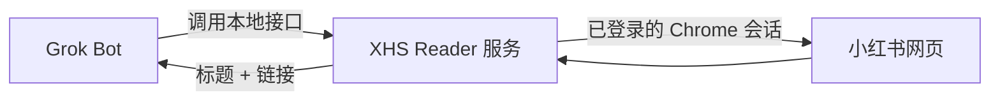

<div align="center">


<h1>XHS Reader</h1>

<p><strong>把小红书搜索接到 Grok Bot 的对话里。</strong></p>

<table align="center">
<tr>
<td align="center" valign="top" width="220">

<br>
<sub><b>小红书</b><br>Drunk　955473847</sub>
</td>
</tr>
</table>

<p><sub>macOS 已实机验证 · 开发中 · 未经授权不能商用</sub></p>

</div>

> [!IMPORTANT]
> 这是一个**非官方**工具。它使用你自己已登录的 Chrome 会话访问小红书网页，与小红书、xAI 均无合作、授权或背书。

## 🧭 它是什么

XHS Reader 是给 Grok Bot 用的小红书搜索桥：Bot 在本地调用这个工具，搜索结果以标题和链接回到对话里。它不是又一个小红书客户端，只做只读检索和投递。

作者：[chenhongtian](https://chenhongtian.com/)（Drunk）。

## 🧩 工作原理



- 本地 HTTP 服务跑在 `127.0.0.1:18765`。
- Bot 请求 `/search?q=` 搜索，再按需请求 `/note?url=` 打开笔记。
- 返回给对话的是标题和链接，而不是整页转述。

## 🎨 界面

macOS 窗口使用 Grok Bot Anywhere 的官方头像动画，并与真实搜索状态同步：开始工作时戴上安全帽、沿一条简单的线向下，下方一行文字只显示程序正在做的事（例如「搜索中」「打开笔记中」）；结束后回到空闲。设置不放在窗口里。

## ⏱ 请求节奏

有每日搜索上限、每日笔记上限，以及两次请求之间的间隔，避免对网页会话过于频繁地请求。当前开发期默认值：每天搜索 50 次、打开笔记 40 次，间隔 6–10 秒。可通过 `settings.json` 或 `POST /settings` 调整，按亚洲/澳门自然日重置。

## 🚀 如何运行

1. 用 Chrome 默认配置（资料名为 Drunk）登录 [小红书网页](https://www.rednote.com/)。
2. 打开 `XHS Reader.app`，或在项目目录运行：

```sh
/usr/bin/python3 xhs_reader.py --service
```

3. 服务地址：`http://127.0.0.1:18765`。可用 `GET /health` 做健康检查，用 `GET /status` 查看当前状态。
4. 保持窗口或服务运行，即可让 Grok Bot 调用搜索。

项目位于 `PROJECT_DIR`。

## ⚖️ 使用限制

本项目未经授权不能商用。

## 👤 作者

- 个人网站：[chenhongtian.com](https://chenhongtian.com/)
