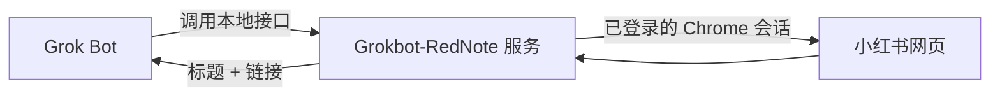

<div align="center">


<h1>Grokbot-RedNote</h1>

<p><strong>把小红书搜索接到 Grok Bot 的对话里。</strong></p>

<table align="center">
<tr>
<td align="center" valign="top" width="280">

<br>
<sub><b>小红书</b><br>Drunk　955473847</sub>
</td>
<td align="center" valign="top" width="280">

<br>
<sub><b>赞赏码</b></sub>
</td>
</tr>
</table>

<p><sub>macOS 已实机验证 · 开发中 · 未经授权不能商用</sub></p>

</div>

> [!IMPORTANT]
> 这是一个**非官方**工具。它使用你自己已登录的 Chrome 会话访问小红书网页，与小红书、xAI 均无合作、授权或背书。

## 🧭 它是什么

Grokbot-RedNote 是给 Grok Bot 用的小红书搜索桥：搜索由 Grok Bot 发起，本地服务用你已登录的 Chrome 会话做只读检索，标题和链接回到对话里。macOS 窗口只用来显示工作过程动画和已保存的结果，不是小红书客户端，窗口里没有搜索框或输入框。

作者：Hongtian Chan（[chenhongtian.com](https://chenhongtian.com/)，Drunk）。

## 🧩 工作原理



- 本地 HTTP 服务跑在 `127.0.0.1:18765`。
- Grok Bot 请求 `/search?q=` 搜索，再按需请求 `/note?url=` 打开笔记；笔记链接经 `/go` 跳到带 `xsec_token` 的官方分享地址。
- 返回给对话的是标题和链接，而不是整页转述。

## 🎨 界面

窗口固定为 520×520 的正方形，可拖动、不可缩放。中央是 Grok Bot Anywhere 的官方头像：忙碌时是思考动画和省略号，结束后播放一次加载动画，再回到开心状态。

精选和搜索记录在头像左侧，全部结果在右侧，都是按钮，点开后展开列表；可分别清空结果或清空记录。设置不放在窗口里。

## ⏱ 请求节奏

对打开笔记仍有每日上限和两次打开之间的间隔，按亚洲/澳门自然日重置。当前开发期默认：每天打开笔记 40 次，间隔 6–10 秒。每日搜索次数上限和搜索之间的间隔目前是关闭的。可通过 `settings.json` 或 `POST /settings` 调整。

本地还会保存最近 50 条搜索记录（`learn.jsonl`），超出的旧记录会自动裁掉。`/tmp` 里的钩子搜索缓存只保留应用需要的编号文件，多余的转储会被清掉。

## 🚀 如何运行

1. 用 Chrome 默认配置登录 [小红书网页](https://www.rednote.com/)。
2. 建议先在项目目录启动服务，再打开应用：

```sh
/usr/bin/python3 grokbot_rednote.py --service
```

然后打开 `Grokbot-RedNote.app`。只先打开应用时，新的权限提示可能导致服务迟迟起不来。

3. 服务地址：`http://127.0.0.1:18765`。可用 `GET /health` 做健康检查，用 `GET /status` 查看当前状态。
4. 保持窗口或服务运行，即可让 Grok Bot 调用搜索。

项目位于 `PROJECT_DIR`。仓库由 Hongtian Chan 维护：[HongtianChan/Grokbot-RedNote](https://github.com/HongtianChan/Grokbot-RedNote)。

## ⚖️ 使用限制

本项目未经授权不能商用。

## 👤 作者

- 个人网站：[chenhongtian.com](https://chenhongtian.com/)
